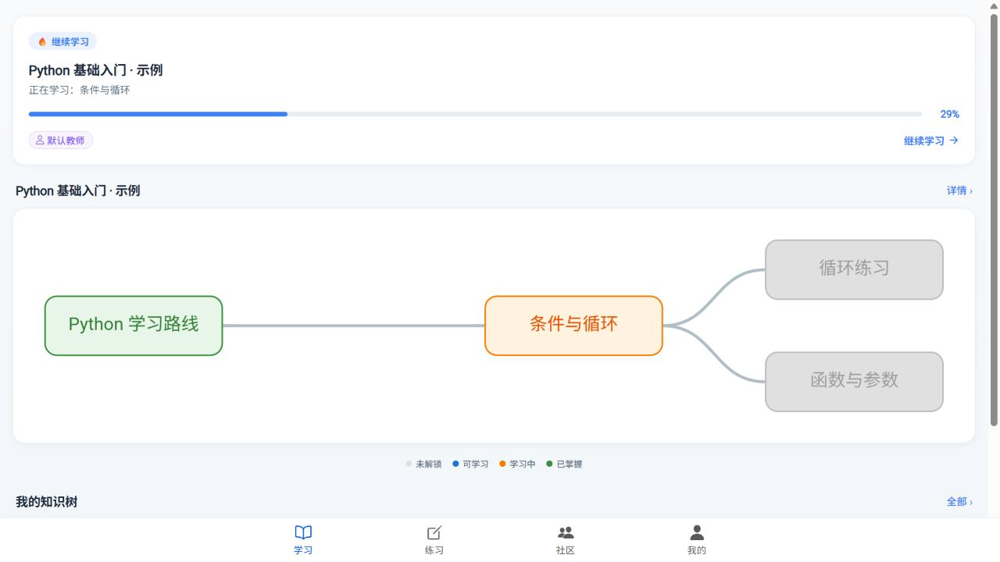
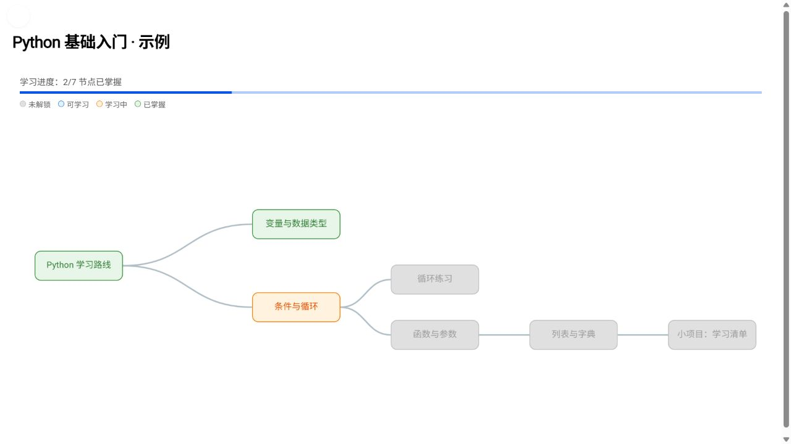
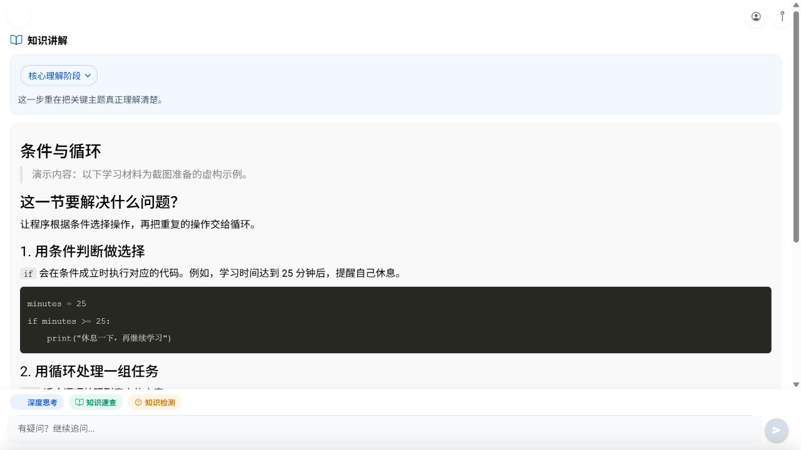
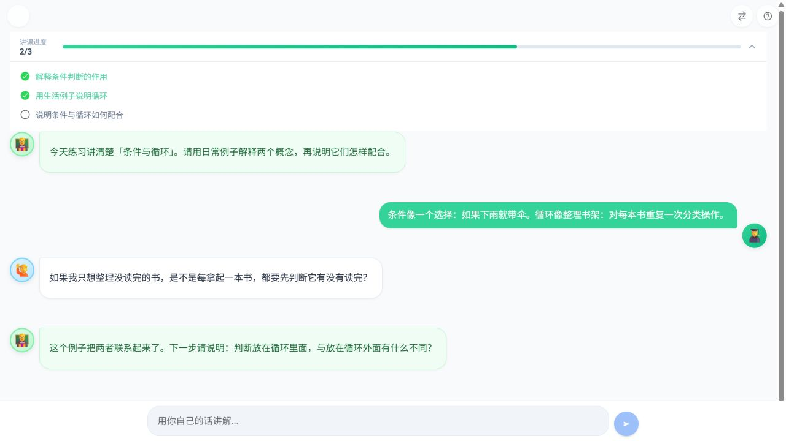
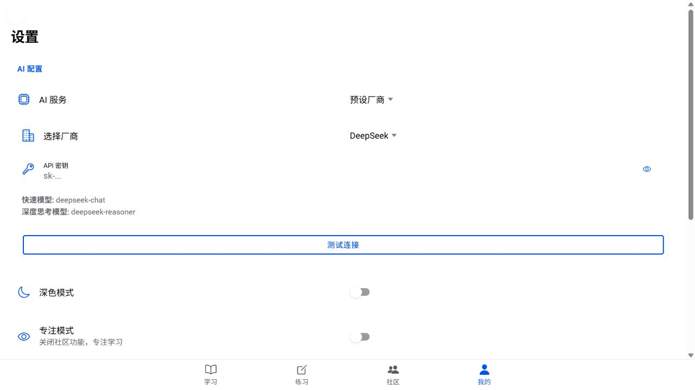

# AiStudy 爱学习

**AI 辅助学习应用｜知识树 · 分阶段讲解 · 费曼课堂**

把一个宽泛的学习目标组织成可以逐步完成的学习路径：查看知识关系，进入具体知识点学习，再通过练习和向“学生”讲解来检查理解。

本仓库用于项目作品展示，公开界面截图、产品流程与技术说明。核心源码保持私有，未授予开源许可。

> **截图说明**：以下图片均来自本地运行的真实应用界面，使用独立准备的虚构示例数据。课程、学习进度和费曼对话用于说明交互，不是真实用户记录，也不代表本次运行生成了这些 AI 回答。截图没有使用真实账号或 API 密钥。

## 解决的问题

学习者往往有一个大目标，却不清楚下一步应该学什么、知识之间有什么依赖，以及自己是否真的理解了。AiStudy 将学习过程拆成三个连续环节：

1. **组织路径**：用知识树呈现知识点、依赖关系和学习状态。
2. **围绕节点学习**：进入某个知识点，查看讲解、阶段目标，并继续提问或进行知识检测。
3. **用讲解检查理解**：在费曼课堂中，学习者向“学生”解释知识，“导师”负责反馈，页面持续显示检查指标。

## 界面展示

### 知识树与学习状态

节点区分未解锁、可学习、学习中和已掌握状态。知识树将“先学什么”和“当前进度”放在同一视图中；首页则聚焦当前节点及附近关系。

### 节点讲解与学习工具

讲解页组合了阶段提示、Markdown 内容、代码示例、追问输入、知识速查及知识检测入口。图中的 Python 材料是专门准备的示例课程。

### 费曼课堂：讲给别人听

界面区分学习者、学生和导师三种角色，并用检查项呈现讲解进度。下图是通过应用的会话恢复功能载入的示例对话；“2/3”表示演示状态，不是模型质量评测成绩。

### 模型服务配置

支持预设厂商与自定义接口，以及快速模型、深度思考模型的配置。截图中的密钥输入框为空，`sk-...` 是输入提示。

## 实现概要

| 层次 | 采用的技术与职责 |
| --- | --- |
| 应用界面 | Angular 18、Ionic 8；独立组件与按路由加载的页面 |
| 知识可视化 | AntV G6；知识树、节点状态与关系展示 |
| AI 交互 | RxJS 管理请求流；流式回答、取消请求与模型切换逻辑 |
| 学习流程 | 将知识讲解、追问、检测与节点状态连接起来 |
| 费曼课堂 | 学生与导师角色分工、检查项、会话状态恢复 |
| 数据服务 | Express、Parse Server、PostgreSQL；学习与会话数据持久化接口 |

更详细的能力边界与验证说明见 [项目说明](docs/project-notes.md)。

## 已验证的范围

- 前端生产构建通过；前后端锁定依赖能够安装。
- 后端语法检查通过；缺少必要凭据时拒绝启动。
- 在隔离演示环境中查看了首页、知识树、节点学习、费曼会话恢复及模型设置页面，并保存以上截图。
- 未连接真实数据库或调用付费模型服务；不将上述页面检查表述为完整业务端到端测试。
- 不宣称已测得学习效果提升、商业用户规模或模型回答准确率。

## 展示与权利范围

公开内容仅包含有限的介绍与截图，不包含源码、构建产物、完整提示词、数据库、账号信息或开发聊天记录。权利说明见 [NOTICE](NOTICE.md)。技术实现细节可在得到授权后进一步演示。
