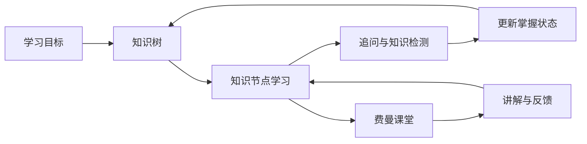

# 项目说明

## 从目标到学习行动

AiStudy 的核心交互围绕知识节点展开。知识树承载路径与依赖，节点页承载学习材料和追问，检测结果与节点状态关联，费曼课堂则让学习者主动组织语言。

这是产品流程示意，不是学习效果的因果证明。

## 关键技术取舍

| 问题 | 当前实现方式 | 需要注意的边界 |
| --- | --- | --- |
| 长回答等待体验 | 流式接收并逐步呈现，支持取消请求 | 流式完成不代表答案正确 |
| 知识路径难以理解 | 图形化节点关系与显式状态 | 路径与前置关系需要校验 |
| 对话角色混淆 | 学生与导师分别承担提问和检查职责 | 角色分工不等于评测已达到稳定准确率 |
| 学习中断后继续 | 保存知识点、对话与会话状态 | 本次截图只检查了本地示例数据的恢复展示 |
| 多模型接入 | 将接口地址、密钥与模型名称独立配置 | 真实接入仍依赖服务商权限、可用性及浏览器网络限制 |

## 截图证据如何理解

| 图片 | 实际呈现的内容 | 不代表的结论 |
| --- | --- | --- |
| 学习首页 | 继续学习入口、当前子树、示例进度 | 不是真实用户活跃度或完成率 |
| 知识树 | 节点、关系和学习状态的可视化 | 不证明路径生成质量 |
| 节点学习 | 阶段提示、课程渲染、追问与检测入口 | 不证明课程由模型实时生成 |
| 费曼课堂 | 多角色消息、检查项、会话恢复 | 不证明模型评分准确，也不是本人开发聊天 |
| 模型设置 | 预设服务商和配置表单 | 不证明各服务商均已连通 |

截图来自真实构建的应用，通过本地模拟接口提供虚构数据。示例数据和截图服务不在本公开仓库中提供；源码与可执行构建也不公开。

## 验证状态

前端生产构建、后端语法检查与缺少凭据时的启动检查已通过。依赖安装及构建仍有旧依赖兼容性、CommonJS 和样式体积警告。本次验证没有覆盖真实数据库集成、真实模型调用、移动端安装包或多用户生产部署。

当前模型密钥由使用者在浏览器中配置。面向多人部署还需要服务端模型代理、权限、配额和数据访问控制；这些不作为已完成能力展示。

## 可供进一步核验的方向

后续演示可围绕同一个虚构学习目标，核验节点选择、状态流转、会话恢复、流式中断与模型错误处理。需要查看实现时，应单独约定授权范围，不因公开展示仓库而开放核心源码。
